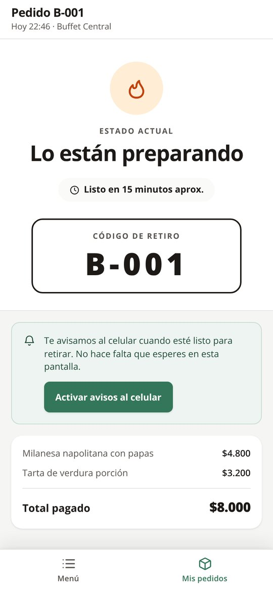
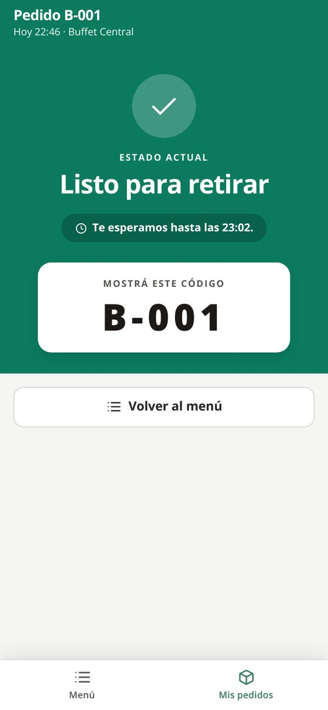
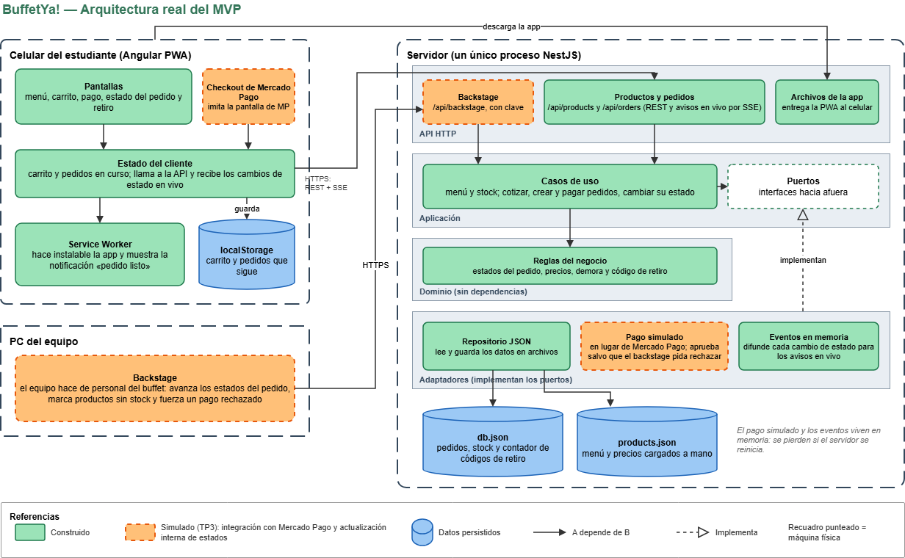

<div align="center">


<h1>BuffetYa!</h1>

<p><strong>Pedí, pagá y retirá en el buffet de la UNLaM sin hacer fila.</strong></p>

<p>
  <a href="https://buffetya.onrender.com"></a>
  
  
  
  
  
</p>

<p>
  <a href="https://buffetya.onrender.com"><strong>Ver la demo</strong></a> ·
  <a href="docs/brief.md">Brief del producto</a> ·
  <a href="#arquitectura">Arquitectura</a> ·
  <a href="#hoja-de-ruta">Hoja de ruta</a>
</p>

&nbsp;
&nbsp;
&nbsp;
&nbsp;


</div>

<br>

## Tabla de contenidos

- [Acerca del proyecto](#acerca-del-proyecto)
  - [Construido con](#construido-con)
- [Funcionalidades](#funcionalidades)
- [Primeros pasos](#primeros-pasos)
  - [Requisitos previos](#requisitos-previos)
  - [Instalación](#instalación)
  - [Uso](#uso)
- [Scripts](#scripts)
- [Despliegue](#despliegue)
- [Arquitectura](#arquitectura)
- [Estructura del proyecto](#estructura-del-proyecto)
- [Hoja de ruta](#hoja-de-ruta)
- [Documentación](#documentación)
- [Equipo](#equipo)
- [Agradecimientos](#agradecimientos)
- [Licencia](#licencia)

## Acerca del proyecto

Entre el trayecto, la fila y el pago, comprar en el buffet de la UNLaM se come buena parte de un recreo corto. En el relevamiento con estudiantes, **el 86% calificó la espera como muy molesta** y **el 100% quería conocer el menú y los precios antes de ir**.

BuffetYa! es una app web instalable (PWA) que permite consultar el menú, armar el pedido, pagarlo desde el celular e irse a hacer otra cosa hasta que la app avise que está listo para retirar.

| | |
|---|---|
| **Usuario primario** | Estudiantes de los departamentos de Derecho y Ciencia Política, Humanidades y Ciencias Sociales y Ciencias de la Salud que usan habitualmente el buffet |
| **Usuarios secundarios** | Docentes y personal administrativo de la UNLaM |
| **Contexto** | Proyecto de la materia Gestión Aplicada al Desarrollo de Software II (3665), Ingeniería Informática, UNLaM, 2.º cuatrimestre 2026 |

### Construido con

| Capa | Tecnología |
|---|---|
| Frontend | [Angular](https://angular.dev) como PWA instalable, con *service worker* |
| Backend | [NestJS](https://nestjs.com), organizado en puertos y adaptadores |
| Tipos compartidos | Paquete `shared` en TypeScript |
| Persistencia | Archivos JSON (MVP) |
| Monorepo | [pnpm workspaces](https://pnpm.io/workspaces) |
| Tests | [Vitest](https://vitest.dev) (unitarios y end-to-end) |
| Despliegue | [Render](https://render.com) |

## Funcionalidades

- **Menú con precios y fotos**, con filtros opcionales: Sin TACC, Vegetariano y Vegano.
- **Carrito** con el tiempo estimado de preparación **antes de pagar**, calculado según los pedidos que hay en cocina.
- **Compra sin registro**: para pedir alcanza con el nombre.
- **Pago** con casos de aprobado y rechazado, y reintento que conserva el carrito.
- **Estado del pedido en vivo** y aviso cuando está listo.
- **Código de retiro** para mostrar en el mostrador.

| Estado | Alcance |
|---|---|
| ✅ Construido | Todo lo anterior, incluido el backend propio |
| 🧪 Simulado | Cobro con Mercado Pago (un checkout que imita al real) y operación del buffet (estados del pedido y stock desde el *backstage* del equipo) |
| ⏳ Diferido | Cuentas e historial, panel del buffet, Mercado Pago real, push con la app cerrada y base de datos en la nube. Ver la [hoja de ruta](#hoja-de-ruta) |

## Primeros pasos

### Requisitos previos

- [Node.js](https://nodejs.org) 22 o superior
- [pnpm](https://pnpm.io/installation), o `corepack enable` para usar la versión fijada en el proyecto

### Instalación

```bash
git clone https://github.com/gadsii-unlam/gadsii-aura-it.git
cd gadsii-aura-it/src
pnpm install
```

No hace falta crear un `.env` para desarrollar. Para cambiar valores, copiá `src/.env.example` a `src/.env`.

### Uso

```bash
pnpm dev
```

| Servicio | URL |
|---|---|
| App | http://localhost:4200 |
| API | http://localhost:3000/api |
| Backstage | http://localhost:4200/backstage (clave `buffetya-dev`) |

El **backstage** es una pantalla interna, no enlazada desde la app, que simula al personal del buffet y a Mercado Pago: avanza los estados del pedido, marca productos sin stock y fuerza un pago rechazado. Cómo usarlo en una sesión de prueba está en [`src/README.md`](src/README.md#backstage-cómo-simular-lo-que-pasa-por-detrás-en-una-sesión-de-prueba).

## Scripts

Se ejecutan desde `src/`.

| Comando | Qué hace |
|---|---|
| `pnpm dev` | Levanta frontend y backend en modo desarrollo |
| `pnpm build` | Compila `shared`, frontend y backend |
| `pnpm start` | Inicia el servidor de producción, que sirve la API y la app compilada |
| `pnpm test` | Corre los tests de todos los paquetes |
| `pnpm lint` | Corre el linter |

## Despliegue

El archivo [`render.yaml`](render.yaml) describe un único *web service* en Render: un proceso de NestJS que sirve la API en `/api` y la PWA compilada en el resto de las rutas, con HTTPS incluido.

> [!NOTE]
> En el plan gratuito, el servicio se duerme a los 15 minutos sin uso, así que la primera visita puede tardar cerca de un minuto. Además, no hay disco persistente: los pedidos se borran en cada reinicio.

> [!WARNING]
> El *service worker* y las notificaciones solo funcionan con HTTPS o en `localhost`.

## Arquitectura

<div align="center">

</div>

La PWA en Angular habla por HTTPS (REST y eventos en vivo) con un único servidor NestJS organizado en capas: API, casos de uso, dominio y adaptadores. El dominio no tiene dependencias externas, y cada integración vive detrás de un puerto. Por eso, reemplazar una pieza simulada por la real es escribir un adaptador nuevo. Las piezas en naranja están simuladas.

La arquitectura de la gran visión está en [`docs/arquitectura/`](docs/arquitectura/).

## Estructura del proyecto

```text
gadsii-aura-it/
├── docs/
│   ├── brief.md            # Brief de producto (v1 a v5)
│   ├── prompts.md          # Registro del trabajo con IA
│   ├── arquitectura/       # Diagramas del MVP y de la gran visión
│   ├── capturas/           # Capturas del MVP
│   ├── diseno/wireframe/   # Alternativas A, B, C y D (la construida)
│   ├── evaluacion/         # Evaluación heurística del TP4
│   └── evidencia/          # Relevamiento (tp2) y prueba con usuarios (tp5)
├── src/
│   ├── frontend/           # PWA en Angular
│   ├── backend/            # API en NestJS
│   │   └── src/
│   │       ├── domain/       # Reglas del negocio
│   │       ├── application/  # Casos de uso y puertos
│   │       └── adapters/     # HTTP, persistencia, pago, eventos
│   └── shared/             # Tipos compartidos
└── render.yaml             # Despliegue en Render
```

## Hoja de ruta

- [x] Menú, carrito, pago simulado, estado del pedido y código de retiro
- [x] Prueba con usuarios reales del segmento
- [x] Despliegue público en Render
- [ ] Aviso de "pedido listo" por push con la app cerrada (Firebase Cloud Messaging)
- [ ] Panel para el personal del buffet: cola de pedidos, estados, stock y menú
- [ ] Cobro real con Mercado Pago y confirmación por webhook
- [ ] Base de datos persistente (Cloud Firestore)
- [ ] Cuentas de usuario e historial de pedidos

> [!IMPORTANT]
> Para salir a producción, el hosting, Firebase y Mercado Pago tienen que quedar a nombre de la institución o del buffet, no de un integrante del equipo. La cuenta de Mercado Pago debe ser la del buffet, que es quien cobra.

## Documentación

| Documento | Contenido |
|---|---|
| [Brief del producto](docs/brief.md) | Segmento, hipótesis de valor, resultados de la prueba y gran visión |
| [Registro de IA](docs/prompts.md) | Cada uso de IA, con fecha, herramienta y resultado |
| [Evidencia del relevamiento](docs/evidencia/tp2/) | Respuestas anonimizadas de la encuesta |
| [Evidencia de la prueba](docs/evidencia/tp5/) | Registro de la prueba del MVP con U1, U2 y U3 |
| [Wireframes](docs/diseno/wireframe/) | Alternativas de diseño y la versión construida |
| [Evaluación de usabilidad](docs/evaluacion/) | Evaluación heurística cruzada, del equipo y de la IA |
| [Guía técnica](src/README.md) | Puesta en marcha, variables de entorno y despliegue |

Cada entrega quedó marcada con un tag: `tp1`, `tp2`, `tp3`, `tp4-entrega`, `tp4`, `tp5`, `tp6` y `tpi`.

## Equipo

**Aura IT**

- Mathieu Andrés Santamaría Loiacono
- Martín Alejandro Didolich
- Alejo Rodrigo Lopez Rodofile
- Agustín Ignacio Garcia Riveros
- Juan Ignacio Bernardez

## Agradecimientos

- A la cátedra de Gestión Aplicada al Desarrollo de Software II de la UNLaM.
- A los estudiantes que respondieron la encuesta y probaron el MVP.
- Las fotos de los productos vienen de [Pexels](https://www.pexels.com) y [Wikimedia Commons](https://commons.wikimedia.org). El detalle de cada una está en [`CREDITS.md`](src/frontend/public/products/CREDITS.md).

## Licencia

Proyecto académico, sin licencia de uso definida.
