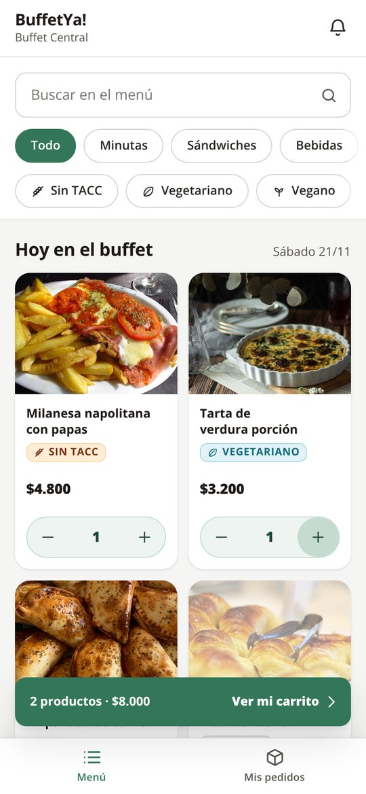
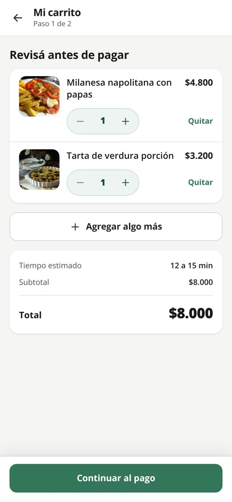
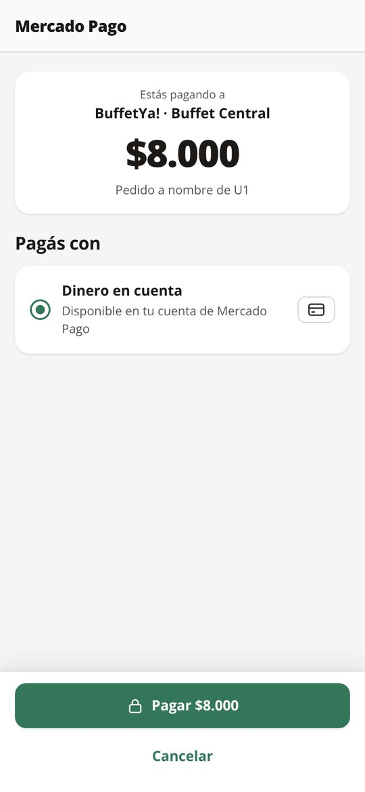
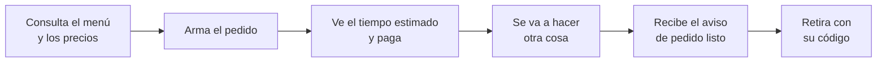

<div align="center">


# BuffetYa!

**Pedí, pagá y retirá en el buffet de la UNLaM sin hacer fila.**

[](https://buffetya.onrender.com)


[Brief del producto](docs/brief.md) · [Arquitectura](#-arquitectura) · [Cómo se ejecuta](#-cómo-se-ejecuta) · [Cómo se continúa](#-cómo-se-continúa)

<br>

<table>
  <tr>
    <td align="center"><br><sub><b>1. Menú</b></sub></td>
    <td align="center"><br><sub><b>2. Carrito</b></sub></td>
    <td align="center"><br><sub><b>3. Pago</b></sub></td>
    <td align="center"><br><sub><b>4. En preparación</b></sub></td>
    <td align="center"><br><sub><b>5. Listo para retirar</b></sub></td>
  </tr>
</table>

<sub>Gestión Aplicada al Desarrollo de Software II (3665) · Ingeniería Informática · UNLaM · 2.º cuatrimestre 2026 · Equipo <b>Aura IT</b></sub>

</div>

> [!NOTE]
> La app corre en el plan gratuito de Render: **la primera carga puede tardar cerca de un minuto** y los pedidos se borran cada vez que el servidor se reinicia.

---

## 🎯 El problema

Entre el trayecto, la fila y el pago, comprar en el buffet se come buena parte de un recreo corto. En el relevamiento, **el 86% de los estudiantes calificó la espera como muy molesta** y **el 100% quería conocer el menú y los precios antes de ir**.

## 👤 Para quién

**Usuario primario:** estudiantes de los departamentos de Derecho y Ciencia Política, Humanidades y Ciencias Sociales y Ciencias de la Salud que usan habitualmente el buffet.
**Grupos secundarios:** docentes y personal administrativo de la UNLaM.

## 🔁 Cómo funciona



Sin registro: para comprar alcanza con el nombre.

## 📦 Estado del producto

| | Qué incluye |
|---|---|
| ✅ **Construido** | PWA instalable · menú con precios y filtros opcionales (Sin TACC, Vegetariano, Vegano) · carrito con tiempo estimado **antes de pagar** · pago aprobado y rechazado · estado del pedido en vivo · código de retiro · backend propio en NestJS |
| 🧪 **Simulado** | Cobro con Mercado Pago (checkout que imita al real) · operación del buffet: estados del pedido y stock desde el *backstage* del equipo |
| ⏳ **Diferido** | Cuentas, perfil e historial · panel del personal del buffet · Mercado Pago real · notificaciones push con la app cerrada · base de datos en la nube |

El detalle completo —segmento, hipótesis de valor, resultados de la prueba con usuarios y gran visión— está en el [**brief del producto**](docs/brief.md) (versión 5).

## 🚀 Cómo se ejecuta

**Requisitos:** Node.js 22 o superior y pnpm.

```bash
cd src
pnpm install
pnpm dev
```

| Qué | Dónde |
|---|---|
| App | http://localhost:4200 |
| API | http://localhost:3000/api |
| Backstage (simula al buffet y a Mercado Pago) | http://localhost:4200/backstage — clave `buffetya-dev` |

La guía completa —build de producción, variables de entorno, deploy en Render con `render.yaml` y cómo operar el backstage en una sesión de prueba— está en [`src/README.md`](src/README.md).

## 🏗 Arquitectura

<div align="center">

</div>

Una PWA en Angular habla con un único servidor NestJS organizado en capas: API, casos de uso, reglas del negocio y adaptadores. Los datos se guardan en archivos JSON y las piezas en naranja están simuladas. La arquitectura de la gran visión está en [`docs/arquitectura/`](docs/arquitectura/).

## 🧭 Cómo se continúa

El backend usa **puertos y adaptadores** (`src/backend/src/`: `domain`, `application`, `adapters`). Reemplazar una pieza simulada por la real es escribir un adaptador nuevo sin tocar las reglas del negocio. Las variables de Firebase y Mercado Pago ya están previstas en `src/.env.example`.

**Orden recomendado para salir a producción:**

1. 🔔 **Aviso de "pedido listo" por push** (Firebase Cloud Messaging). Hoy solo llega con la app abierta: es el componente más riesgoso.
2. 🧑‍🍳 **Panel del personal del buffet**, que reemplace al backstage: cola de pedidos, estados, stock y carga del menú.
3. 💳 **Mercado Pago real**, con confirmación del pago por webhook.
4. 🗄 **Base de datos persistente** (Cloud Firestore) en lugar del archivo JSON.

> [!IMPORTANT]
> Antes de transferir el proyecto, el hosting, Firebase y Mercado Pago tienen que quedar a nombre de la institución o del buffet, no de un integrante del equipo. La cuenta de Mercado Pago debe ser la del buffet, que es quien cobra.

## 🗂 Mapa del repositorio

| Ruta | Contenido |
|---|---|
| [`docs/brief.md`](docs/brief.md) | Brief de producto, versiones 1 a 5 |
| [`docs/prompts.md`](docs/prompts.md) | Registro del trabajo con IA |
| [`docs/evidencia/tp2/`](docs/evidencia/tp2/) | Respuestas de la encuesta del relevamiento (anonimizadas) |
| [`docs/evidencia/tp5/`](docs/evidencia/tp5/) | Registro de la prueba del MVP con usuarios (U1, U2, U3) |
| [`docs/diseno/wireframe/`](docs/diseno/wireframe/) | Alternativas de diseño A, B y C, y alternativa D (B con las correcciones del TP4), que es la construida |
| [`docs/evaluacion/`](docs/evaluacion/) | Evaluación heurística cruzada del TP4 (equipo e IA) |
| [`docs/arquitectura/`](docs/arquitectura/) | Arquitectura real del MVP y de la gran visión |
| [`docs/capturas/`](docs/capturas/) | Capturas del MVP en funcionamiento |
| [`src/`](src/) | Código fuente: `frontend/` (Angular), `backend/` (NestJS), `shared/` |

## 🏷 Líneas base

| Tag | Trabajo práctico |
|---|---|
| `tp1` | Definición del producto y del segmento |
| `tp2` | Análisis de usuarios e hipótesis de valor |
| `tp3` | Scope del MVP y diseño de la interacción |
| `tp4-entrega` | Material entregado al equipo evaluador en el TP4 |
| `tp4` | Evaluación de usabilidad |
| `tp5` | Construcción del MVP, prueba y aprendizaje |
| `tp6` | Arquitectura del sistema |
| `tpi` | Trabajo Práctico Integrador |

## 👥 Equipo Aura IT

| Integrante |
|---|
| Mathieu Andrés Santamaría Loiacono |
| Martín Alejandro Didolich |
| Alejo Rodrigo Lopez Rodofile |
| Agustín Ignacio Garcia Riveros |
| Juan Ignacio Bernardez |
